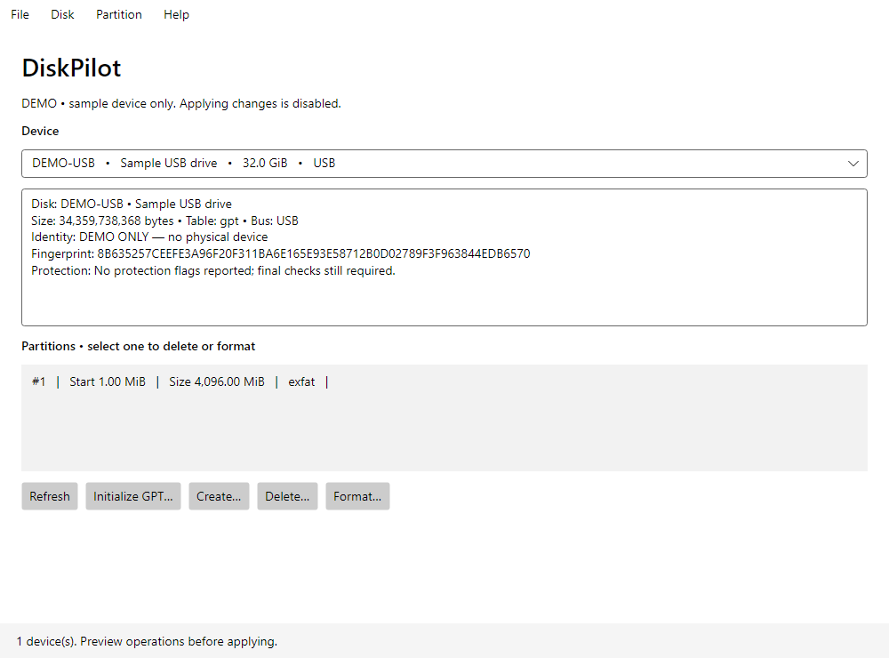

# DiskPilot (partition manager)

A small, deliberately conservative **.NET 10 partition manager for Windows and Linux**, with a command-line
interface and an optional Avalonia desktop GUI. It discovers disks, shows partition geometry and file systems,
and can initialize GPT, create, delete and format partitions by calling the operating system's own storage tools
(Windows Storage PowerShell module, GNU Parted and `mkfs.*` on Linux). **No application code opens a raw disk for writing.**

> **Status:** an initial implementation, not a production-certified disk utility. Back up important data and
> validate with disposable media first. Changes are irreversible; there is no undo, recovery, resizing or
> automatic rollback.



## Contents

| Path | What it is |
|---|---|
| `DiskPilot.csproj` | CLI project (`net10.0`, warnings as errors, embeds `windows.ps1`) |
| `Program.cs` | CLI parsing, dry-run preview, typed confirmation and execution sequence |
| `Core.cs` | Inventory records, SHA-256 disk fingerprint, `Safety` policy, native process runner |
| `OperationSession.cs` | Shared preview/apply coordinator used by the GUI (re-validates before any write) |
| `WindowsBackend.cs` + `windows.ps1` | Windows backend: Storage cmdlets via an encoded, non-interactive Windows PowerShell 5.1 call |
| `LinuxBackend.cs` | Linux backend: `lsblk`, sysfs, `findmnt`, `wipefs`, `parted`, `mkfs.*` |
| `Gui/` | Avalonia 11.3.9 desktop GUI (`DiskPilot.Gui.csproj`, `MainWindow.cs`, `Program.cs` with `--demo` backend) |
| `Gui/Tests/` | Headless GUI smoke test (demo backend only, never touches disks) |
| `tests/` | Dependency-free managed safety/backend tests and Windows backend fixture tests (`WindowsBackend.Tests.ps1`) |
| `NuGet.Config` | Clears all package feeds on purpose (see *Build*) |

## Quick start

```text
# CLI: build, run the tests, list disks (read-only)
dotnet restore tests/DiskPilot.Tests.csproj --configfile NuGet.Config
dotnet build tests/DiskPilot.Tests.csproj -c Release --no-restore
dotnet tests/bin/Release/net10.0/DiskPilot.Tests.dll
dotnet bin/Release/net10.0/DiskPilot.dll list

# GUI: try it safely with the built-in demo device
dotnet restore Gui/DiskPilot.Gui.csproj --configfile NuGet.Config --source https://api.nuget.org/v3/index.json
dotnet build Gui/DiskPilot.Gui.csproj -c Release --no-restore
dotnet run --project Gui/DiskPilot.Gui.csproj -c Release --no-build -- --demo
```

## CLI reference

```text
DiskPilot list [--json]
DiskPilot show --disk ID [--json]
DiskPilot init   --disk ID --fingerprint HASH [--apply | --dry-run]
DiskPilot create --disk ID --fingerprint HASH --start-mib N --size-mib N [--apply | --dry-run]
DiskPilot delete --disk ID --fingerprint HASH --partition N [--apply | --dry-run]
DiskPilot format --disk ID --fingerprint HASH --partition N --fs ext4|exfat|fat32|ntfs [--apply | --dry-run]
DiskPilot help
```

| Switch | Meaning |
|---|---|
| `--disk ID` | Exact disk ID from `list` (Windows disk number such as `3`; Linux whole-disk path such as `/dev/sdb`) |
| `--fingerprint HASH` | Full SHA-256 fingerprint shown by `list`/`show`; must still match at apply time |
| `--start-mib N`, `--size-mib N` | `create` only: explicit start and size in whole MiB |
| `--partition N` | `delete`/`format` only: partition number from `show` |
| `--fs` | `format` only: `ntfs`, `exfat`, `fat32` (Windows and Linux) or `ext4` (Linux only) |
| `--dry-run` | Default behaviour; may be stated explicitly. Cannot be combined with `--apply` |
| `--apply` | Perform the change after an interactive typed confirmation (elevated, interactive terminal only) |
| `--json` | Machine-readable output for `list`/`show` |

Unknown commands, unsupported options for a command, duplicate options and missing values are rejected.
Every change command is a **dry run unless `--apply` is given**. With `--apply` you must type the exact phrase
`ERASE <disk-id> <fingerprint> <operation>`; there is no `--yes`, no piped confirmation and no environment bypass.

## GUI usage

The `Gui` project is a simple Avalonia desktop interface for Windows and Linux using the same backends and
safety rules as the CLI. It requires the .NET 10 runtime; native disk utilities remain required.

- **Windows:** run `DiskPilot.Gui.exe` from a published folder. To apply changes, close it and use **Run as administrator**. Discovery may also require elevation under local policy.
- **Linux:** run `dotnet DiskPilot.Gui.dll`. Avalonia 11 uses X11/XWayland; the desktop needs its usual X11, fontconfig and native graphics libraries. Applying changes requires a root process with access to the display session. Use your desktop's trusted elevated-launch setup; do not disable display security. If your desktop does not support elevated graphical apps, use the CLI for writes.
- **Demo mode:** `--demo` uses a fixture device (`DEMO-USB`) and applying is disabled.

| Menu | Tasks |
|---|---|
| File | Refresh devices, Exit |
| Disk | View details, Initialize GPT |
| Partition | Create, Delete, Format |
| Help | Safety and usage, About |

Select a disk from the dropdown; select a partition before Delete or Format. Each task opens settings, then a
**Preview only** step showing the dry run and exact target. **Continue to confirmation** opens a separate dialog
where the full displayed phrase must match before **Apply change** can write. Closing a dialog cancels without
writing. `OperationSession` re-reads the disk and checks identity, layout, privileges and that the native plan is
unchanged immediately before applying. Background work keeps the window responsive; competing operations and
closing the main window are blocked while a task is active.

The GUI does not bypass protections, elevate itself, unmount disks or provide an undo. Native operations get no
interactive stdin, so hidden console prompts fail instead of hanging. Linux ext4 formatting uses a single `-F` after
confirmation; it never uses the double-force mounted-device override.

## Safety model (summary)

- **Dry run by default**, both in the CLI and the GUI (Preview step).
- **Fingerprint pinning:** writes need the disk's SHA-256 fingerprint (ID, identity/serial, model, size); a full
  geometry/usage snapshot is compared again after confirmation, and on Windows once more inside the PowerShell
  process right before the Storage call.
- **Typed confirmation:** `ERASE <disk-id> <fingerprint> <operation>`, interactive only.
- **System-disk refusal:** Windows boot/system disks, boot/system/active/hidden/special partitions, pagefile disks,
  read-only/offline/unhealthy disks and virtual/RAID/Storage Spaces buses are refused. Linux refuses the root device
  (and fails closed if it can't be mapped, e.g. WSL/containers), mounts including swap, holders/stacked devices and
  non-data partition types.
- **Unused disks only:** every partition on the disk must be unmounted (no drive letters/folder mounts); DiskPilot never unmounts anything itself.
- **GPT writes only:** MBR disks are display-only; `init` only works on an uninitialized, empty disk.
- **Data partitions only:** delete/format are limited to Microsoft basic-data or Linux-data GPT types.
- **No shell interpolation:** explicit executable paths, argument arrays, Base64-encoded JSON for PowerShell input,
  JSON-quoted device labels on screen.

Note that DiskPilot lists all disks it can see (fixed, USB, SD), not only USB media; protection comes from the
refusal rules above rather than from hiding disks.

## Build and tests

From this directory, on either OS:

```text
dotnet restore tests/DiskPilot.Tests.csproj --configfile NuGet.Config
dotnet build tests/DiskPilot.Tests.csproj -c Release --no-restore
dotnet tests/bin/Release/net10.0/DiskPilot.Tests.dll
dotnet bin/Release/net10.0/DiskPilot.dll help
```

The bundled `NuGet.Config` deliberately **clears all feeds** because the CLI has no external packages. Anything
that needs packages (the GUI, the GUI tests, self-contained publishing) must pass `--source https://api.nuget.org/v3/index.json`
explicitly, as shown below. On Windows also run the backend fixture tests (they replace native disk commands with
fixtures and never modify disks):

```powershell
powershell.exe -NoProfile -File tests/WindowsBackend.Tests.ps1
```

GUI build, publish and headless smoke test (the smoke test never accesses disks):

```text
dotnet restore Gui/DiskPilot.Gui.csproj --configfile NuGet.Config --source https://api.nuget.org/v3/index.json
dotnet build Gui/DiskPilot.Gui.csproj -c Release --no-restore
dotnet publish Gui/DiskPilot.Gui.csproj -c Release --no-restore --self-contained false -o dist/gui

dotnet restore Gui/Tests/DiskPilot.Gui.Tests.csproj --configfile NuGet.Config --source https://api.nuget.org/v3/index.json
dotnet run --project Gui/Tests/DiskPilot.Gui.Tests.csproj -c Release --no-restore
```

Publish on the destination OS to get its native launcher. For self-contained builds use `-r win-x64` or
`-r linux-x64` with `--self-contained true` and the explicit `--source`. Keep the entire published directory;
native libraries are not bundled into a single executable.

## Running the CLI

Examples use `dotnet DiskPilot.dll` from a published portable directory; from a build tree use
`dotnet bin/Release/net10.0/DiskPilot.dll`.

```text
dotnet DiskPilot.dll list
dotnet DiskPilot.dll list --json
dotnet DiskPilot.dll show --disk ID
```

Match **model, capacity, identity/serial and physical device**, then copy the full `Fingerprint` value. Do not
assume any sample ID refers to spare media. Fingerprints include the device address and identity; Linux also
includes the kernel disk sequence when available, so reconnecting a device can change its fingerprint.

Each command below is a **dry run** by default. Substitute the actual ID and HASH:

```text
dotnet DiskPilot.dll init --disk ID --fingerprint HASH
dotnet DiskPilot.dll create --disk ID --fingerprint HASH --start-mib 16 --size-mib 1024
dotnet DiskPilot.dll format --disk ID --fingerprint HASH --partition 1 --fs exfat
dotnet DiskPilot.dll delete --disk ID --fingerprint HASH --partition 1
```

- `init` creates GPT only when the OS reports an uninitialized disk with no partitions. Linux additionally refuses any signature reported by wipefs. **Windows RAW does not prove a disk is blank**: initialization can overwrite unrecognized metadata, so use it only on media you intend to initialize. There is no whole-disk wipe command.
- `create` uses positive, whole binary MiB (1,048,576 bytes), an explicit start and size, checks overlaps, and reserves at least 1 MiB at the end for GPT metadata. Native tools perform additional alignment and geometry checks. Start at 16 MiB is a convenient example for a newly initialized Windows GPT disk with a reserved area. Always inspect the actual layout first.
- `create` does not format or mount. Linux creates a Linux-data GPT partition; Windows creates basic-data. Formatting does not convert partition type; for a Linux-created exFAT/NTFS/FAT32 partition intended for Windows, set the Microsoft basic-data type with the OS disk manager first.
- Partition numbers are from `show`; do not assume the new partition is #1, especially after Windows GPT initialization.
- Windows FAT32 size limits come from Format-Volume. Windows Format-Volume defaults to quick format and Linux NTFS formatting is quick; neither is secure erasure.

After reviewing a dry run, repeat the same command with `--apply` in an elevated **interactive terminal** (on Linux
prefix with `sudo`) and type the exact displayed phrase. Dry runs perform discovery and checks but run no
partition-changing commands; they are plan previews and cannot guarantee the native operation will succeed. Linux
signature probes may need root even in dry-run mode.

## Support

| Feature | Windows | Linux |
|---|---|---|
| Discovery/layout | Storage PowerShell module | lsblk, sysfs, findmnt, parted |
| Initialize/create/delete | Initialize-Disk, New-Partition, Remove-Partition | GNU Parted |
| Format | Format-Volume: NTFS, exFAT, FAT32 | mkfs.ext4, mkfs.exfat, mkfs.fat, mkfs.ntfs |
| Partition tables | GPT writes; MBR display only | GPT writes; MBR display only |
| Media | Basic fixed disks, USB and SD | Kernel `disk` devices including fixed/USB/SD |

Excluded: dynamic disks, Storage Spaces, RAID/LVM/crypt/multipath, loop devices, recovery/EFI/special partitions, mounted disks, unsupported filesystems, and most virtual buses on Windows. An MSR (Microsoft Reserved) partition may coexist on a data disk but cannot be deleted or formatted. Basic SCSI disks may be supplied by a VM or controller; only configurations exposed as ordinary basic disks are supported. Hardware RAID internals cannot be detected reliably through standard disk enumeration.

## Prerequisites

- Build: .NET 10 SDK. Runtime for the portable build: .NET 10 runtime. The CLI uses no third-party NuGet packages; the GUI uses Avalonia 11.3.9.
- Windows: Windows 11 or a supported Windows Server with Windows PowerShell 5.1, the Storage module, and CIM access. Use **Run as Administrator** for writes; local security policy may also require elevation for discovery.
- Linux: a normal host installation with udev, procfs and sysfs, and modern util-linux supporting `lsblk --json` and `MOUNTPOINTS`. This is not intended for WSL, containers, or live overlay-root environments: unknown root-device mapping disables writes.
- Debian/Ubuntu native tools: `sudo apt install util-linux parted udev e2fsprogs exfatprogs dosfstools ntfs-3g`. On other distributions install the equivalent packages. Only the requested filesystem formatter is needed; parted and udev are needed for discovery.

## Preparing an unused disk

All partitions on a selected disk must be unused, including siblings of the target. Close applications using the disk. On Linux, unmount its filesystems through your desktop disk utility or `umount` using the exact verified partition paths. Disable active swap through normal system administration first. DiskPilot never unmounts anything automatically.

On Windows, remove drive letters and folder mount points for the intended data disk through Disk Management. Volume GUID paths are normal and are not treated as user mount points. The native format/delete commands are called without `-Force`; open handles or other OS restrictions may still cause refusal. DiskPilot does not forcibly dismount volumes, disable encryption, bring disks online, or change read-only flags. Reassign a drive letter in Disk Management after formatting if desired.

## Safeguards and limitations (detail)

- Read-only/offline/unhealthy Windows disks, Windows boot/system/active/hidden/special partitions and pagefile disks are refused. Linux rejects any mount (including swap), non-data partition type, special partition flag, stacked child or sysfs holder, and unknown root-device mapping.
- Errors in required discovery commands fail closed instead of assuming an unused disk.
- SHA-256 fingerprint and a full geometry/usage snapshot are checked again after confirmation. Windows repeats identity/layout checks inside the PowerShell process immediately before the Storage call. Linux repeats the signature probe for initialization.
- Executables use explicit OS paths, argument arrays and no shell interpolation. PowerShell input data travels as encoded JSON; device metadata is quoted for display. Native tools must be trusted and installed in administrator-owned locations.
- There is still a small **time-of-check/time-of-use window** between the final check and the OS operation. The tool does not hold an exclusive device lock across discovery and execution and cannot prevent an unrelated administrator, automounter or hot-plug event. Stop automounters for the disposable test disk and do not attach/detach devices or run other storage tools during an operation.
- Detection protects the running OS and recognizable boot metadata; it cannot prove that an unmounted ordinary data partition does not contain another OS or valuable files. Unrecognized or damaged partition tables need specialist tools.
- Failure may follow a partial change, including a failure to refresh the kernel view or the final display. Inspect with the OS disk utility before retrying. Never assume an error means nothing changed.

## Packaging the CLI for both OSes

Portable, framework-dependent folder (same DLL runs on Windows and Linux with .NET 10 installed):

```text
dotnet publish DiskPilot.csproj -c Release --no-restore --self-contained false -p:UseAppHost=false -o dist/portable
```

Copy the entire publish folder, including `.deps.json` and `.runtimeconfig.json`. Run `dotnet DiskPilot.dll`. Native OS tools remain required. 

Optional self-contained per-platform executables (publishing needs internet access for official .NET runtime packs; explicitly supply a feed because NuGet.Config clears sources):

```text
dotnet publish DiskPilot.csproj -c Release -r win-x64 --self-contained true -p:PublishSingleFile=true --source https://api.nuget.org/v3/index.json -o dist/win-x64
dotnet publish DiskPilot.csproj -c Release -r linux-x64 --self-contained true -p:PublishSingleFile=true --source https://api.nuget.org/v3/index.json -o dist/linux-x64
```

For ARM64 use `win-arm64` or `linux-arm64`. On Linux, run `chmod +x DiskPilot` after extraction, then `./DiskPilot list` or `sudo ./DiskPilot ... --apply`. On Windows run `DiskPilot.exe` from an elevated terminal. Self-contained builds do not bundle PowerShell, Storage, parted or filesystem utilities.

## Validation status and disposable-media acceptance test

Validated on the author's Windows machine (October 2026): release builds with zero warnings, 46 managed safety/backend tests, 5 Windows native-backend fixture tests, the headless GUI smoke test, and help output. Read-only live Windows discovery was attempted but CIM access was denied by the session; the app exited without mutation. Linux execution and actual destructive operations were not tested here. Treat the acceptance test below as required before relying on the tool.

1. Use a backed-up, disposable USB stick on each OS; keep your main OS on a separate disk. Confirm `list` marks the system disk protected. Verify a wrong fingerprint and a mounted test partition are refused even in dry-run mode.
2. On media prepared as uninitialized by the OS disk manager, preview then apply `init`; inspect the resulting GPT layout with Disk Management or `lsblk`/`parted`.
3. Choose an unallocated region, preview then apply `create`. Verify exact offset/size and that existing partitions remain unchanged. List again to find its partition number.
4. Preview then apply `format` for each supported filesystem of interest. Mount using the OS, write/read a test file, then unmount/remove drive letters again.
5. Preview then apply `delete` for that partition only. Verify unrelated partitions and their data are intact.
6. Cancel a confirmation, supply an incorrect phrase, and attempt an overlapping create; verify no changes. Do not hot-unplug during an active write.

## References

Native API references: [New-Partition](https://learn.microsoft.com/en-us/powershell/module/storage/new-partition), [Remove-Partition](https://learn.microsoft.com/en-us/powershell/module/storage/remove-partition), [Format-Volume](https://learn.microsoft.com/en-us/powershell/module/storage/format-volume), [lsblk](https://man7.org/linux/man-pages/man8/lsblk.8.html), [wipefs](https://man7.org/linux/man-pages/man8/wipefs.8.html), [GNU Parted manual](https://www.gnu.org/software/parted/manual/parted.html).
